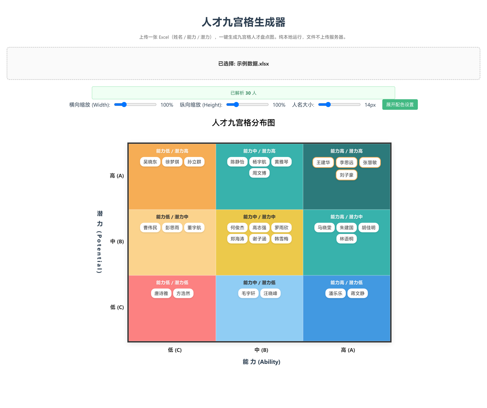
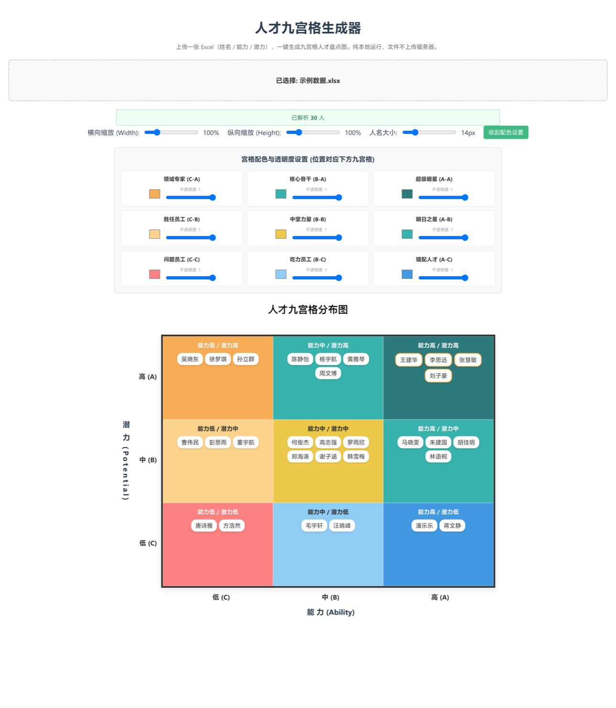

<p align="center">
  
</p>

<h1 align="center">人才九宫格生成器 · Talent Nine Grid</h1>

<p align="center">
  上传一张 Excel，一键把「姓名 / 能力 / 潜力」画成九宫格人才盘点图。纯前端，零安装，可离线。
</p>

<p align="center">
  
  
  
  
  
</p>

---

## ✨ 这是什么？

做人才盘点、干部评估、梯队建设的人，几乎每年都要画一遍九宫格：把一批人按「能力」和「潜力」两个维度打分，再落到 3×3 的格子里看分布。

这件事本可以直接在 Excel 里画，但每次都要重画色块、挪名字、调字号；用 PPT 画更麻烦，人一多格子就装不下。

**这个工具把它压成一步**：你只管在 Excel 里填三列——姓名、能力（A/B/C）、潜力（A/B/C），拖进来就出图。配色、字号、缩放都能现场调，调好会自动记住。

它没有后端、不联网、不上传任何数据，全部在你的浏览器里跑完。构建产物是**单个 HTML 文件**，拷给同事双击就能用。

## 🎯 功能

| 功能 | 说明 |
|---|---|
| 📄 拖拽上传 | 支持 `.xlsx` / `.xls`，拖进来或点选都行，只读第一张工作表 |
| 🧮 自动分格 | 按 B 列（能力）× C 列（潜力）落入九宫格，大小写都能识别 |
| 🧹 容错提示 | 中间有空行、或某行能力/潜力填错，只跳过那一行并在顶部提示跳过了谁，不会整表失败 |
| 🎨 九格配色 | 九个格子各自选底色 + 不透明度，实时预览 |
| 🔤 字号缩放 | 人名字号 10–30px、横向/纵向整体缩放 50%–300%，人多也不挤 |
| 💾 记忆设置 | 配色与字号存在浏览器本地，下次打开还是你那套 |
| ✏️ 标题可改 | 图表标题直接点着改，方便截图进方案 |
| 🔒 纯本地 | 无后端、无网络请求、无埋点，数据不出本机 |

## 📸 界面

| 生成结果 | 配色设置 |
|---|---|
|  |  |

## 🚀 三种用法

### 1. 只要能用（推荐给 HR / 顾问 / 不写代码的人）

到 [Releases](../../releases) 下载 `talent-nine-grid.html`，**双击用浏览器打开**即可。不需要装 Node、不需要联网，也不依赖任何服务器。

> 想放到共享盘给全组用，把这个 HTML 丢进去就行，谁打开都是独立运行的本地工具。

### 2. 本地开发

```bash
git clone https://github.com/egohuger/talent-nine-grid.git
cd talent-nine-grid
npm install
npm run dev        # 打开 http://localhost:5173
```

### 3. 自己构建单文件

```bash
npm run build      # 产物：dist/index.html（JS/CSS/图标全部内联，就这一个文件）
```

把 `dist/index.html` 改个名字发给别人即可，`node_modules` 和源码都不需要带走。

## 📋 Excel 格式要求

第 1 行是表头（写什么无所谓），**从第 2 行开始填人**。列顺序不能变，多余列会被忽略：

| 列 | 内容 | 取值 |
|---|---|---|
| A | 姓名 | 任意文本 |
| B | 能力 | `A` / `B` / `C` |
| C | 潜力 | `A` / `B` / `C` |

仓库里带了一份可直接用的 [`examples/示例数据.xlsx`](examples/示例数据.xlsx)（30 人，另一张表写了填写说明）：

| 姓名 | 能力 | 潜力 |
|---|---|---|
| 王建华 | A | A |
| 陈静怡 | B | A |
| 吴晓东 | C | A |
| 唐诗雅 | C | C |

**填报注意**：不要在中间插空行（插了也不会崩，但会少统计）；能力/潜力留空或写了「高/优秀」这类值，该行会被跳过并在页面顶部列出姓名；只读第一张工作表。

## 🧭 九宫格默认口径

横轴是「能力」（左低右高），纵轴是「潜力」（下低上高）。九个格子自带默认角色名，可按贵司口径替换：

| | 潜力高 | 潜力中 | 潜力低 |
|---|---|---|---|
| **能力高** | 超级明星 | 明日之星 | 错配人才 |
| **能力中** | 核心骨干 | 中坚力量 | 吃力员工 |
| **能力低** | 领域专家 | 胜任员工 | 问题员工 |

> 这只是常见叫法。工具本身不判断人，只负责按你打好的 A/B/C 落格。

## 🏗️ 项目结构

```
talent-nine-grid/
├── index.html                      # 入口页（标题、图标、描述）
├── vite.config.js                  # Vite + singlefile 插件（构建出单个 HTML）
├── examples/示例数据.xlsx           # 可试用的示例数据（30 人）
└── src/
    ├── main.js                     # 应用入口
    ├── App.vue                     # 页面骨架：标题 / 上传区 / 提示 / 图表
    ├── style.css                   # 全局样式
    ├── components/
    │   ├── FileUpload.vue          # 拖拽 / 点选上传
    │   └── NineGrid.vue            # 九宫格本体：坐标轴、九个格子、配色面板、缩放控件
    └── composables/
        └── useGridData.js          # Excel 解析 → 九格数据 + 容错统计
```

技术栈：Vue 3（`<script setup>`）· Vite 7 · SheetJS(xlsx) · SCSS · vite-plugin-singlefile

## ⚙️ 常见问题

**Q：数据会传到服务器吗？**
A：不会。没有任何后端和网络请求，Excel 在你的浏览器内存里解析完就渲染，断网也能用。

**Q：人多会不会卡、格子装不下？**
A：几百人没问题。单个格子内容超出时会独立滚动，不会撑破版式；也可以用「横向/纵向缩放」把人名排得松一些。

**Q：配色能保存下来吗？**
A：存在浏览器 localStorage 里（键名 `nine-grid-settings`），同一浏览器下次打开自动生效。隐私模式下可能不保存。

**Q：能导出 PNG 图片吗？**
A：暂时不能，目前靠截图。要放进方案的话，建议把字号调大、缩放调到 120% 再截。已列入后续计划。

**Q：WPS 导出的文件能读吗？**
A：只要是真 Excel 格式（`.xlsx` / `.xls`）就能读。把 WPS 的 `.et` 直接改后缀成 `.xlsx` 不保证可用。

**Q：为什么页面提示「跳过 N 行」？**
A：那几行的能力或潜力列不是 A/B/C（可能写了「高」「优秀」或留空）。工具会跳过并列出姓名，改成单字母即可。

## 📌 更新记录

**v1.0.0**（首个公开版本）

- 修复：Excel 中间有空行时整表解析中断、空行之后的人全部丢失（`useGridData.js` 里的 `continued;` 拼写错误）
- 新增：解析结果提示（解析到几人、跳过几行、跳过的姓名）
- 新增：示例数据、单文件构建配置、README 与 MIT 许可证

## 🐛 反馈与建议

- **提 Issue**（推荐）：到 [Issues](../../issues) 选「Bug 反馈」或「功能建议」
- **邮件**：[egohug@126.com](mailto:egohug@126.com) · **微信**：`egohughu`

反馈 Bug 时请说明浏览器和操作系统版本；如果要附 Excel，请先把真实姓名替换掉。

## 🔔 关注更新

到本仓库点 **Watch → Custom → 勾选 Releases**，有新版本会收到通知；顺手点个 ⭐ 也行。

<table>
  <tr>
    <td align="center">
      
      <br><strong>公众号「岱森LIVE」</strong>
      <br>人、AI、效率、社会
    </td>
    <td align="center">
      <br><br>
      <strong style="font-size:18px;">💬 个人微信</strong>
      <br><br>
      <code style="font-size:16px;">egohughu</code>
      <br><br>
      添加备注「九宫格」<br>交流使用、反馈问题
    </td>
  </tr>
</table>

## 📄 许可证

[MIT](LICENSE) © 2026 egohug

随便用、随便改、随便分发，包括商用；保留版权声明即可。

<p align="center"><strong>如果它省下了你重画格子的那半小时，点个 ⭐ 让更多人找到它。</strong></p>
